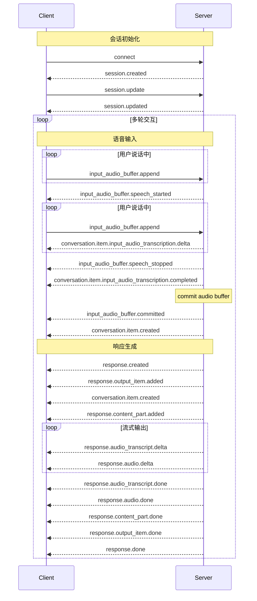
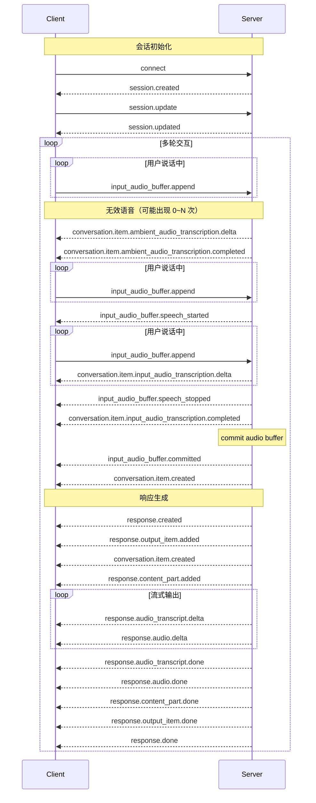
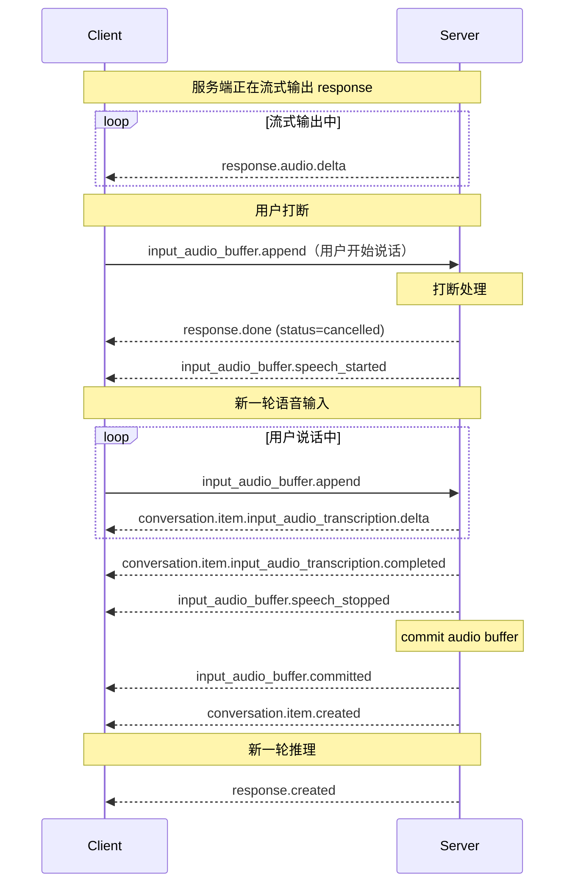
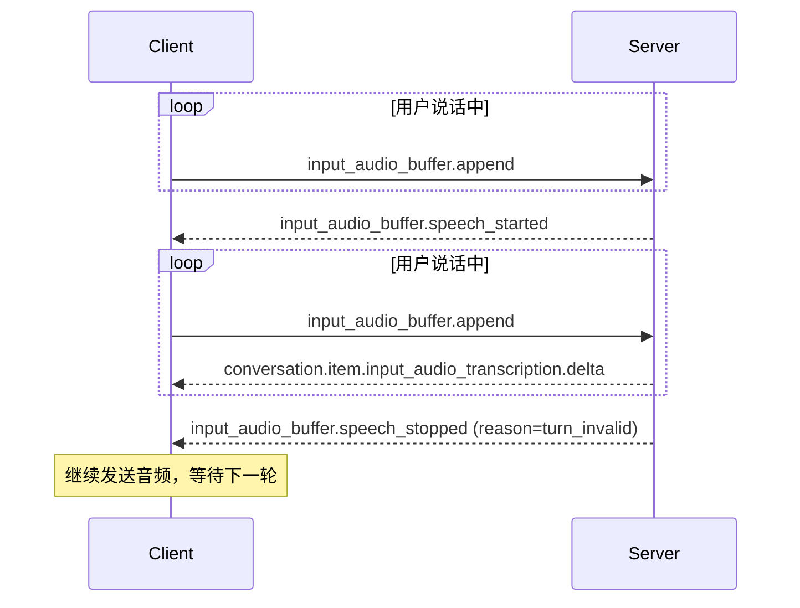
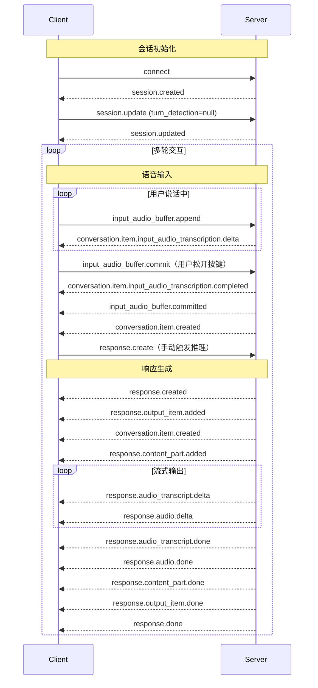
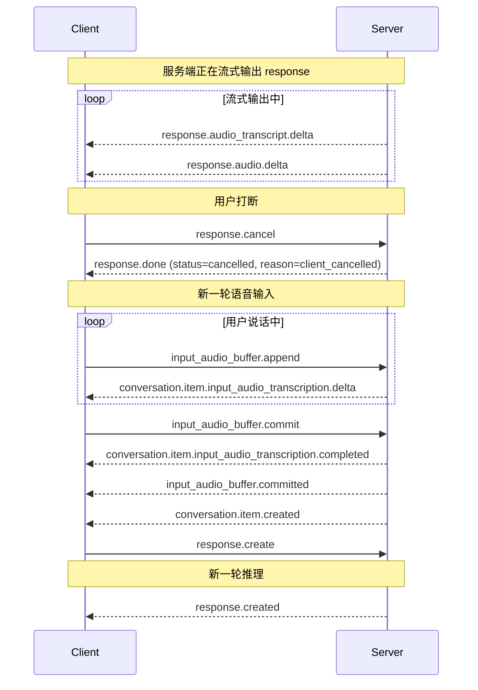
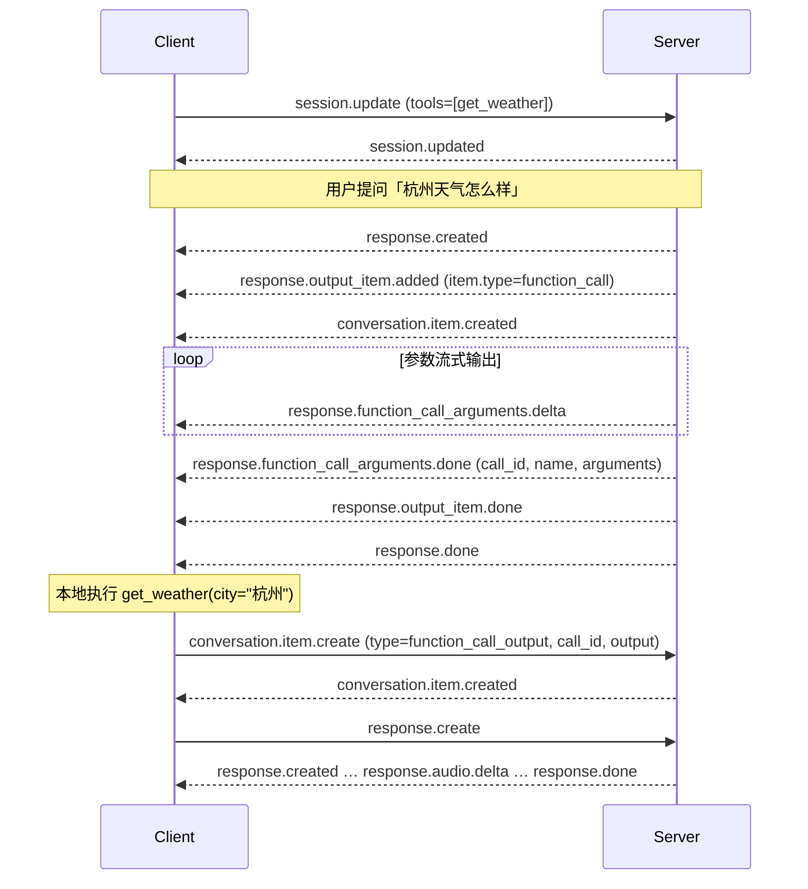
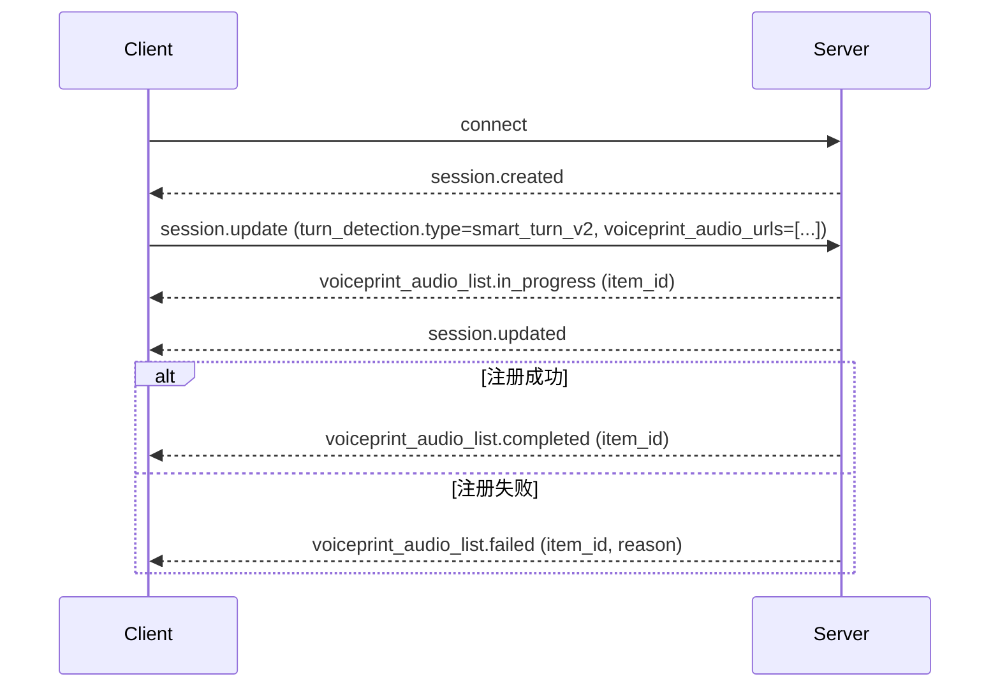
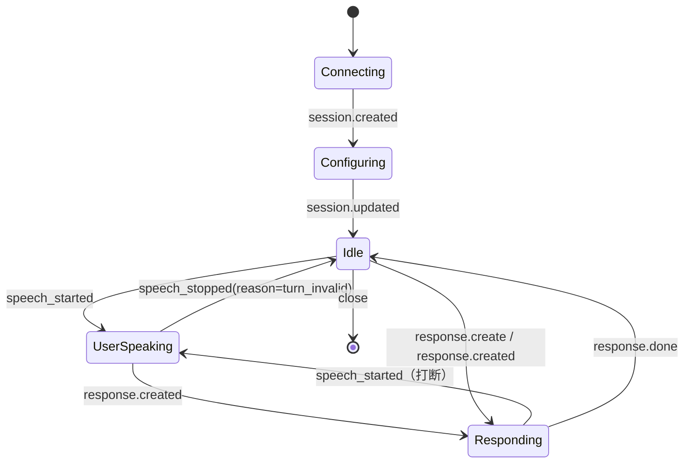

# Qwen-Audio-Realtime WebSocket 接入接口文档与使用说明

> 适用范围：阿里云百炼（Model Studio）实时语音对话模型 Qwen-Audio-Realtime，**基于原始 WebSocket 协议接入**（不依赖 Node.js / Android / iOS / HarmonyOS SDK）。  
> 信息来源：阿里云帮助中心《实时语音对话》目录下的「概述」「WebSocket > 接入」「客户端事件」「服务端事件」四篇文档。  
> 整理日期：2026-11-17（官方文档更新时间：2026-11-06）。

源文档：

- 概述：<https://help.aliyun.com/zh/model-studio/voice-conversation-api-references>
- WebSocket 接入：<https://help.aliyun.com/zh/model-studio/audio-realtime-websocket-access>
- 客户端事件：<https://help.aliyun.com/zh/model-studio/fun-audiochat-client-events>
- 服务端事件：<https://help.aliyun.com/zh/model-studio/qwen-audio-realtime-server-events>

相关参考（本文未展开）：

- 用户指南：<https://help.aliyun.com/zh/model-studio/fun-audiochat-realtime>
- 音色配置：<https://help.aliyun.com/zh/model-studio/qwen-audio-realtime-user-guides#fc60h311>
- 声音复刻 API：<https://help.aliyun.com/zh/model-studio/voice-clone-design-http-api#h3-create-enrollment>
- 生成临时 API Key：<https://help.aliyun.com/zh/model-studio/generate-temporary-api-key>
- 错误码：<https://help.aliyun.com/zh/model-studio/error-code>

> 本文中标注「**[整理补充]**」的内容为基于官方文档的推导或工程建议，非官方原文，使用时请自行验证。

---

## 目录

- [1. 概述](#1-概述)
- [2. 接入准备](#2-接入准备)
- [3. 协议约定](#3-协议约定)
- [4. 音频约束](#4-音频约束)
- [5. 核心概念](#5-核心概念)
- [6. 交互模式](#6-交互模式)
- [7. 交互时序](#7-交互时序)
- [8. 各模式操作约束](#8-各模式操作约束)
- [9. 客户端事件总表](#9-客户端事件总表)
- [10. 会话配置 session.update](#10-会话配置-sessionupdate)
- [11. 音频输入 input_audio_buffer.*](#11-音频输入-input_audio_buffer)
- [12. 上下文管理 conversation.item.*](#12-上下文管理-conversationitem)
- [13. 推理控制 response.create / response.cancel](#13-推理控制-responsecreate--responsecancel)
- [14. 服务端事件总表](#14-服务端事件总表)
- [15. 服务端事件详解：会话与错误](#15-服务端事件详解会话与错误)
- [16. 服务端事件详解：输入音频与 VAD](#16-服务端事件详解输入音频与-vad)
- [17. 服务端事件详解：对话项与 ASR 转写](#17-服务端事件详解对话项与-asr-转写)
- [18. 服务端事件详解：响应输出](#18-服务端事件详解响应输出)
- [19. 服务端事件详解：声纹注册](#19-服务端事件详解声纹注册)
- [20. Function Calling](#20-function-calling)
- [21. 说话人增强（声纹）](#21-说话人增强声纹)
- [22. 错误处理](#22-错误处理)
- [23. 推荐接入流程](#23-推荐接入流程)
- [24. 最小实现示例（Python）](#24-最小实现示例python)
- [25. 开发注意事项](#25-开发注意事项)

---

## 1. 概述

Qwen-Audio-Realtime 用于**实时语音对话**。模型支持**文本和流式音频输入**，可返回**文本和音频**。

支持的模型（均支持 WebSocket、WebRTC 和 AOQ 三种协议）：

| 模型 | 说明 |
| --- | --- |
| `qwen-audio-3.1-realtime-plus` | 3.1 Plus |
| `qwen-audio-3.1-realtime-flash` | 3.1 Flash |
| `qwen-audio-3.0-realtime-plus` | 3.0 Plus |
| `qwen-audio-3.0-realtime-flash` | 3.0 Flash |

协议选型：

| 协议 | 传输方式 | 备注 |
| --- | --- | --- |
| **WebSocket**（本文） | 通过事件收发音频和文本，音频以 Base64 内嵌在 JSON 事件中。 | 浏览器原生支持；长期 API Key 应保存在服务端。 |
| WebRTC | 音频轨道收发语音，DataChannel 收发文本和模型事件。 | — |
| AOQ（AI over QUIC） | Client SDK 传输音频，独立 Data 轨收发文本和模型事件。 | Client SDK 支持 Android、iOS、HarmonyOS、Windows、macOS、Electron、Linux。 |

- 三种协议的事件定义**均以 WebSocket 接入为基础**；WebRTC / AOQ 只是把媒体走媒体轨道、事件走各自的数据通道。
- 三种协议均可用于 Token Plan，可用模型和地域以 Token Plan 个人版及团队版说明为准。

---

## 2. 接入准备

### 2.1 服务地址

WebSocket URL 固定，通过查询参数 `model` 指定模型：

| 地域 | WebSocket URL |
| --- | --- |
| 华北2（北京） | `wss://{WorkspaceId}.cn-beijing.maas.aliyuncs.com/api-ws/v1/realtime?model=<model_name>` |
| 新加坡 | `wss://{WorkspaceId}.ap-southeast-1.maas.aliyuncs.com/api-ws/v1/realtime?model=<model_name>` |

- `{WorkspaceId}` 替换为真实的百炼业务空间 ID（[获取方式](https://help.aliyun.com/zh/model-studio/regions#h2_migrate_domain)）。
- `<model_name>` 替换为第 1 节中的模型名，例如 `qwen-audio-3.1-realtime-plus`。
- URL **必须使用 `wss://`**。Authorization 在请求头中设置，模型通过 URL 查询参数指定。

> **域名迁移**：百炼为华北2（北京）、新加坡推出了业务空间专属域名，性能与稳定性更好，建议迁移：
>
> - 华北2（北京）：`dashscope.aliyuncs.com` → `{WorkspaceId}.cn-beijing.maas.aliyuncs.com`
> - 新加坡：`dashscope-intl.aliyuncs.com` → `{WorkspaceId}.ap-southeast-1.maas.aliyuncs.com`
>
> 现有域名仍可正常使用。

### 2.2 鉴权（请求头）

| 字段 | 类型 | 必选 | 说明 |
| --- | --- | --- | --- |
| `Authorization` | string | 是 | 鉴权令牌，格式 `Bearer <your_api_key>`。 |
| `user-agent` | string | 否 | 客户端标识，便于服务端追踪来源。 |
| `X-DashScope-WorkSpace` | string | 否 | 百炼业务空间 ID。 |
| `X-DashScope-DataInspection` | string | 否 | 数据合规检查配置，按模型要求使用。`qwen-audio-3.1-realtime-plus` 的官方示例使用了 `x-dashscope-dataInspection: disable`。 |

注意：

- Authorization 在 **WebSocket 握手阶段**验证。API Key 无效或缺失时握手失败，返回 HTTP **401/403**。
- **长期 API Key 应保存在服务端**，不要放入浏览器或移动端应用。需要在客户端直连时可使用[临时 API Key](https://help.aliyun.com/zh/model-studio/generate-temporary-api-key)。
- **[整理补充]** 浏览器原生 `WebSocket` 无法设置自定义请求头，Web 端推荐由后端代理建立到百炼的 WSS 连接并注入 `Authorization`，前端只连自己的后端。

### 2.3 握手失败排查

握手失败时依次核对：域名、地域、业务空间、API Key、模型名称、模型开通状态与权限。完整错误信息见[错误码](https://help.aliyun.com/zh/model-studio/error-code)。

---

## 3. 协议约定

| 约定 | 说明 |
| --- | --- |
| **JSON 文本帧** | 客户端事件与服务端事件均为 JSON，事件类型由顶层 `type` 字段标识。 |
| **type 路由** | 双方均按 `type` 分发处理，例如 `session.update`、`response.audio.delta`。 |
| **服务端公共字段** | 所有服务端事件均包含 `event_id`（服务端自动生成）和 `type`。 |
| **音频承载** | 上行音频放在 `input_audio_buffer.append.audio`，下行音频放在 `response.audio.delta.delta`，均为 **Base64 编码的 PCM**。 |
| **会话** | 一次 WebSocket 连接对应一个会话，连接建立后服务端首先下发 `session.created`。 |

**[整理补充]** 官方事件列表中没有显式的「结束会话」事件，会话随 WebSocket 连接关闭而结束。

---

## 4. 音频约束

### 4.1 输入音频

| 项 | 值 |
| --- | --- |
| 格式（`input_audio_format`） | `pcm`（当前仅支持，默认值） |
| 采样率 | 16 kHz |
| 位深 | 16 bit |
| 声道 | 单声道 |
| 发送节奏 | 持续、高频发送，如每 **20~40 ms** 一帧 |
| 编码 | Base64 后放入 `input_audio_buffer.append` 的 `audio` 字段 |

**[整理补充]** 16 kHz × 16 bit × 单声道 = 32000 字节/秒，即 20 ms = **640 字节**，40 ms = **1280 字节**。

### 4.2 输出音频

| 项 | 值 |
| --- | --- |
| 格式（`output_audio_format`） | `pcm`（当前仅支持，默认值） |
| 采样率 | 24 kHz |
| 位深 | 16 bit |
| 声道 | 单声道 |
| 下发事件 | `response.audio.delta`（`delta` 字段为 Base64 PCM 片段） |

`input_audio_format` 仅在首次发送音频之前（IDLE 状态）允许修改。

---

## 5. 核心概念

- **Session（会话）**：一次 WebSocket 连接对应一个会话，会话内维护配置和对话上下文。
- **Conversation Item（对话项）**：对话中的每条消息，**按链表顺序组织**（通过 `previous_item_id` 串联）。
- **Response（响应）**：一次模型推理产生的输出，包含一个或多个输出项；输出项可以是助手消息（`message`），也可以是函数调用（`function_call`）。
- **Function Call（函数调用）**：模型请求客户端执行工具函数时产生的输出项。客户端执行完成后通过 `function_call_output` 写回结果，再用 `response.create` 触发下一轮推理。
- **Turn Detection（轮次检测）**：控制何时触发推理。

---

## 6. 交互模式

通过 `session.update` 的 `session.turn_detection` 配置。自动检测模式设置对象内的 `type`；push-to-talk 模式将整个 `turn_detection` 设为 `null`。**若不提供该字段，系统默认启用 server_vad。**

| 模式 | `session.turn_detection` 的值 | 描述 | 适用场景 |
| --- | --- | --- | --- |
| server_vad（默认） | `{"type": "server_vad", ...}` | 服务端 VAD 检测语音起止，自动触发推理。 | 免提对话、语音助手 |
| 智能语义轮次 | `{"type": "smart_turn"}` 或 `{"type": "smart_turn_v2"}`（推荐） | 融合声学感知与语义理解判断轮次边界。无语义声音（如「嗯」「啊」）不会触发对话轮，也不会打断模型播报。 | 低延迟自然对话、高质量打断 |
| push-to-talk | `null` | 客户端手动提交音频、手动触发推理。 | 按键说话、精确控制 |

### 6.1 server_vad

服务端对传入音频做语音活动检测，检测到语音结束（静音达到 `silence_duration_ms`）后自动触发推理。模型播报期间若 VAD 检测到用户开始说话，服务端会取消当前响应（`response.done`，`status=cancelled`，`reason=turn_detected`），随后开始新一轮语音输入和响应。

### 6.2 smart_turn / smart_turn_v2

与 server_vad 的主要区别：

- 无语义声音（「嗯」「啊」、背景音等）**不会触发推理**，而是通过 `conversation.item.ambient_audio_transcription.delta/completed` 透传，不写入对话上下文。
- 已判定有效的语音可能被**撤回**：`input_audio_buffer.speech_stopped` 返回 `reason=turn_invalid`，此时不触发推理，客户端应继续发送音频等待下一轮有效语音。
- 在等待用户下一轮输入时，客户端可显式发送 `response.create` 触发推理。
- `silence_duration_ms` 在此模式下无效。
- `smart_turn_v2`（推荐）在 `smart_turn` 基础上增强对话上下文理解，更好地判断多人场景中的交互意图，减少旁人说话或无关插话造成的误回复、误打断。
- 支持说话人增强（声纹），见第 21 节。

打断处理与 server_vad 基本一致。

### 6.3 push-to-talk

1. 客户端持续发送 `input_audio_buffer.append`。
2. 用户说完（如松开按键）后发送 `input_audio_buffer.commit` 提交缓冲区。
3. 发送 `response.create` 手动触发推理。
4. 服务端流式返回文本和音频。

打断：客户端发送 `response.cancel`，服务端返回 `response.done`（`status=cancelled`，`reason=client_cancelled`）。

---

## 7. 交互时序

以下时序图根据官方文档中的时序图整理。

### 7.1 server_vad 典型时序



### 7.2 server_vad 用户打断


### 7.3 smart_turn / smart_turn_v2 典型时序



### 7.4 smart_turn / smart_turn_v2 用户打断



> 注意：smart_turn 模式下 `transcription.completed` 可能先于 `speech_stopped` 到达（与 server_vad 顺序相反），客户端不要依赖二者的先后顺序。

### 7.5 smart_turn / smart_turn_v2 无效轮次



### 7.6 push-to-talk 典型时序



### 7.7 push-to-talk 用户打断



---

## 8. 各模式操作约束

| 操作 | push-to-talk | server_vad | smart_turn / smart_turn_v2 |
| --- | --- | --- | --- |
| `session.update` | IDLE 时全部可改；非 IDLE 时部分受限 | 同左 | 同左 |
| `input_audio_buffer.append` | 允许 | 允许 | 允许 |
| `input_audio_buffer.commit` | 允许 | **忽略** | **忽略** |
| `input_audio_buffer.clear` | 允许 | **忽略** | **忽略** |
| `response.create` | 允许（需先 `input_audio_buffer.commit` 提交音频；有响应正在生成时不允许重复触发） | 当前无响应生成时允许；有响应生成时不允许重复触发 | 等待用户下一轮输入时允许；处于一个 turn 内（收到 `input_audio_buffer.speech_started` 到 `response.done` 期间）不允许 |
| `response.cancel` | 允许（推理中） | 允许（推理中） | 允许（推理中） |
| `conversation.item.create/delete/retrieve` | 允许 | 允许 | 允许 |

仅能在 IDLE（首次发送音频之前）修改的字段：

- `turn_detection`
- `input_audio_format`

仅在**第一次** `session.update` 生效、后续传入被忽略的字段：

- `voice`
- `turn_detection.voiceprint_audio_urls`

---

## 9. 客户端事件总表

| 事件 | 作用 | 服务端响应 |
| --- | --- | --- |
| `session.update` | 更新会话配置 | `session.updated` 或 `error` |
| `input_audio_buffer.append` | 追加音频到输入缓冲区 | 无确认回包 |
| `input_audio_buffer.commit` | 提交缓冲区为用户消息（仅 push-to-talk） | `input_audio_buffer.committed`、`conversation.item.created` |
| `input_audio_buffer.clear` | 清空未提交音频（仅 push-to-talk） | `input_audio_buffer.cleared` |
| `conversation.item.create` | 手动插入对话项（上下文 / 工具结果） | `conversation.item.created` 或 `error` |
| `conversation.item.retrieve` | 查询对话项 | `conversation.item.retrieved` |
| `conversation.item.delete` | 删除对话项 | `conversation.item.deleted` |
| `response.create` | 显式触发一次推理 | `response.created` … `response.done` |
| `response.cancel` | 取消当前推理 | `response.done`（`status=cancelled`）；无进行中推理时返回 `error` |

---

## 10. 会话配置 session.update

建立连接后发送此事件更新会话默认配置。**仅包含需要变更的字段，未传字段保持原值**。服务端校验参数：不合法返回 `error`；合法则应用更改并返回带完整配置的 `session.updated`。

### 10.1 顶层字段

| 字段 | 类型 | 必选 | 说明 |
| --- | --- | --- | --- |
| `type` | string | 是 | 固定为 `session.update`。 |
| `session` | object | 否 | 会话配置，见 10.2。 |

### 10.2 `session` 字段

| 字段 | 类型 | 必选 | 说明 |
| --- | --- | --- | --- |
| `modalities` | array | 否 | 输出模态。`["text"]`：仅文本；`["audio", "text"]`（默认）：文本 + 音频。 |
| `voice` | string | 否 | TTS 音色。3.1 默认 `longanqian_v3.1`，3.0 默认 `longanqian`。支持系统音色和声音复刻音色。**仅首次 `session.update` 可设置**，后续传入被忽略。见 10.3。 |
| `speech_rate` | float | 否 | 输出语速，范围 `[0.5, 2.0]`，默认 `1.0`。值越小越慢。适用于全部 4 个模型。 |
| `enable_speech_emotion` | boolean | 否 | 情绪增强，开启后回复音色情绪变化更明显。默认 `true`。 |
| `instructions` | string | 否 | 系统指令，设定角色身份、回答风格和行为偏好，对整个会话生效。 |
| `input_audio_format` | string | 否 | 输入音频格式，当前仅 `pcm`（16kHz 16bit 单声道，默认）。仅 IDLE 可改。 |
| `output_audio_format` | string | 否 | 输出音频格式，当前仅 `pcm`（24kHz 16bit 单声道，默认）。 |
| `input_audio_transcription` | object | 否 | 输入音频转写配置（仅 3.1 Plus/Flash）。见 10.4。 |
| `output_audio` | object | 否 | 输出音频配置（仅 3.1 Plus/Flash）。见 10.5。 |
| `max_history_turns` | integer | 否 | 单次请求允许的最大历史 QA 轮数，范围 1-50，默认 20。 |
| `enable_search` | boolean | 否 | 联网搜索，默认 `false`。开启后模型自主判断是否搜索。适用于全部 4 个模型。可与 `tools` 同时使用。 |
| `search_options` | object | 否 | 联网搜索配置，仅 `enable_search=true` 时生效。见 10.6。 |
| `tools` | array | 否 | Function Calling 工具列表。见 10.7。 |
| `turn_detection` | object \| null | 否 | 轮次检测配置；`null` 为 push-to-talk；不提供则默认启用 server_vad。仅 IDLE 可改。见 10.8。 |

### 10.3 音色（`voice`）

| 类别 | 可选值 |
| --- | --- |
| 3.1 Plus/Flash 系统音色 | `longanqian_v3.1` 及 3.1 TTS Plus/Flash 音色列表中的全部音色，见[音色配置](https://help.aliyun.com/zh/model-studio/qwen-audio-realtime-user-guides#fc60h311)。 |
| 3.0 Plus/Flash 系统音色 | `longanqian`、`longanlingxin`、`longanlingxi`、`longanxiaoxin`、`longanlufeng` |
| 声音复刻音色 | 通过[声音复刻 API](https://help.aliyun.com/zh/model-studio/voice-clone-design-http-api#h3-create-enrollment) 创建，将返回的 `voice_id` 填入。 |

```json
{
    "type": "session.update",
    "session": {
        "voice": "longanqian_v3.1"
    }
}
```

### 10.4 `session.input_audio_transcription`

| 字段 | 类型 | 必选 | 说明 |
| --- | --- | --- | --- |
| `language` | string | 否 | 输入音频源语种：`zh` 中文、`en` 英语、`ja` 日语、`ko` 韩语、`vi` 越南语、`th` 泰语、`id` 印尼语、`ar` 阿拉伯语、`fr` 法语、`de` 德语、`es` 西班牙语、`pt` 葡萄牙语、`ru` 俄语、`it` 意大利语。 |

### 10.5 `session.output_audio`

| 字段 | 类型 | 必选 | 说明 |
| --- | --- | --- | --- |
| `language` | string | 否 | 输出音频目标语种，取值同 10.4。 |

`output_audio.language` 作用于 **TTS**：尽可能让语音使用目标语种，但不保证生效，**也不会改变回复文本的语种**。如需模型生成目标语种文本，请在 `instructions` 中明确要求。

### 10.6 `session.search_options`

| 字段 | 类型 | 必选 | 说明 |
| --- | --- | --- | --- |
| `enable_source` | boolean | 否 | 是否返回搜索结果来源，`true` 时返回。 |

### 10.7 `session.tools[]`

| 字段 | 类型 | 必选 | 说明 |
| --- | --- | --- | --- |
| `type` | string | 是 | 固定为 `function`。 |
| `function.name` | string | 是 | 工具函数名称。 |
| `function.description` | string | 否 | 工具功能描述，模型据此判断是否调用。 |
| `function.parameters` | object | 否 | 入参描述（JSON Schema）。函数无入参时可不指定。 |
| `function.parameters.type` | string | 是 | 固定为 `object`。 |
| `function.parameters.properties` | object | 否 | 各入参的名称、类型与说明。 |
| `function.parameters.required` | array | 否 | 必填入参列表。 |

### 10.8 `session.turn_detection`

| 字段 | 类型 | 必选 | 说明 |
| --- | --- | --- | --- |
| `type` | string | 否 | `server_vad`（默认）、`smart_turn`、`smart_turn_v2`（推荐）。 |
| `threshold` | float | 否 | VAD 灵敏度，范围 `[-1.0, 1.0]`，默认 `0.5`。值越低越容易把微弱声音（含噪声）识别为语音；值越高越需要清晰响亮的语音。三种类型均适用。 |
| `silence_duration_ms` | integer | 否 | 语音结束后的最短静音时长（ms），达到后触发响应。范围 `[200, 6000]`，默认 `800`，对话场景推荐 400-800。**仅 server_vad 生效**。 |
| `voiceprint_audio_urls` | array | 否 | **仅 smart_turn / smart_turn_v2 生效**。目标用户预录音频的公网 URL 列表，用于说话人增强，最多 5 个，格式 16kHz PCM 或 WAV。**仅第一次 `session.update` 可配置**。见第 21 节。 |

### 10.9 示例

基础配置（3.1，server_vad）：

```json
{
    "type": "session.update",
    "session": {
        "modalities": ["text", "audio"],
        "voice": "longanqian_v3.1",
        "speech_rate": 1.2,
        "turn_detection": {
            "type": "server_vad",
            "threshold": 0.5,
            "silence_duration_ms": 800
        }
    }
}
```

语言配置（3.1，输入中文、输出英语）：

```json
{
    "type": "session.update",
    "session": {
        "input_audio_transcription": { "language": "zh" },
        "output_audio": { "language": "en" }
    }
}
```

Function Calling：

```json
{
    "type": "session.update",
    "session": {
        "modalities": ["text", "audio"],
        "voice": "longanqian_v3.1",
        "tools": [
            {
                "type": "function",
                "function": {
                    "name": "get_weather",
                    "description": "查询指定城市天气",
                    "parameters": {
                        "type": "object",
                        "properties": {
                            "city": { "type": "string", "title": "城市" }
                        },
                        "required": ["city"]
                    }
                }
            }
        ],
        "turn_detection": {
            "type": "server_vad",
            "threshold": 0.5,
            "silence_duration_ms": 800
        }
    }
}
```

push-to-talk：

```json
{
    "type": "session.update",
    "session": {
        "turn_detection": null
    }
}
```

声纹注册：

```json
{
    "type": "session.update",
    "session": {
        "turn_detection": {
            "type": "smart_turn_v2",
            "voiceprint_audio_urls": [
                "https://example.com/speaker1.pcm",
                "https://example.com/speaker2.wav"
            ]
        }
    }
}
```

---

## 11. 音频输入 input_audio_buffer.*

### 11.1 input_audio_buffer.append

追加音频到输入缓冲区。应**持续、高频发送**（如每 20~40 ms 一帧）。**无服务端确认回包**。

| 字段 | 类型 | 必选 | 说明 |
| --- | --- | --- | --- |
| `type` | string | 是 | 固定为 `input_audio_buffer.append`。 |
| `audio` | string | 是 | Base64 编码的音频数据（PCM 16kHz 16bit 单声道）。 |

```json
{
    "type": "input_audio_buffer.append",
    "audio": "<base64 编码的音频数据>"
}
```

### 11.2 input_audio_buffer.commit

**仅 push-to-talk 模式**。将缓冲区音频提交为一条用户消息。提交后**不会自动触发推理**，需再发 `response.create`。server_vad / smart_turn / smart_turn_v2 下被忽略。

| 字段 | 类型 | 必选 | 说明 |
| --- | --- | --- | --- |
| `type` | string | 是 | 固定为 `input_audio_buffer.commit`。 |

```json
{ "type": "input_audio_buffer.commit" }
```

服务端响应：`input_audio_buffer.committed` → `conversation.item.created`。

### 11.3 input_audio_buffer.clear

**仅 push-to-talk 模式生效**。清空缓冲区中尚未提交的音频。其他模式下被忽略。

| 字段 | 类型 | 必选 | 说明 |
| --- | --- | --- | --- |
| `type` | string | 是 | 固定为 `input_audio_buffer.clear`。 |

```json
{ "type": "input_audio_buffer.clear" }
```

服务端响应：`input_audio_buffer.cleared`。

---

## 12. 上下文管理 conversation.item.*

### 12.1 conversation.item.create

手动向对话上下文插入一条对话项，用于注入历史上下文、补充文本信息，或写回 Function Calling 的工具执行结果。**若 `item.id` 已存在，返回错误并拒绝创建。**

| 字段 | 类型 | 必选 | 说明 |
| --- | --- | --- | --- |
| `type` | string | 是 | 固定为 `conversation.item.create`。 |
| `previous_item_id` | string | 否 | 新项插入到哪条对话项之后；不传时追加到末尾。 |
| `item` | object | 是 | 要创建的对话项。 |
| `item.id` | string | 否 | 对话项 ID；不传由服务端生成；重复则报错。 |
| `item.type` | string | 是 | `message`：普通消息；`function_call`：函数调用请求（通常由服务端生成，客户端也可用于补充历史）；`function_call_output`：工具执行结果。 |
| `item.role` | string | message 必选 | `system`、`user`、`assistant`。 |
| `item.content` | array | message 必选 | 消息内容列表，元素含 `type` 及对应数据字段，见下表。 |
| `item.call_id` | string | function_call / function_call_output 必选 | 函数调用唯一标识，关联请求与结果。 |
| `item.name` | string | function_call 必选 | 函数名称。 |
| `item.arguments` | string | function_call 必选 | 调用参数，JSON 字符串。 |
| `item.output` | string | function_call_output 必选 | 工具执行结果，JSON 字符串。 |

`content` 元素类型：

| role | content.type | 必填字段 |
| --- | --- | --- |
| `system` | `input_text` | `text` |
| `user` | `input_text` | `text` |
| `user` | `input_audio` | `audio`（Base64） |
| `assistant` | `output_text` | `text` |

注入用户文本消息：

```json
{
    "type": "conversation.item.create",
    "previous_item_id": "item_xxx",
    "item": {
        "id": "my_item_001",
        "type": "message",
        "role": "user",
        "content": [
            { "type": "input_text", "text": "请帮我总结一下上次的对话" }
        ]
    }
}
```

写回 Function Calling 结果：

```json
{
    "type": "conversation.item.create",
    "item": {
        "type": "function_call_output",
        "call_id": "call_xxx",
        "output": "{\"temperature\":18,\"condition\":\"晴\"}"
    }
}
```

### 12.2 conversation.item.retrieve

查询服务端存储的某条对话项。音频类 content **仅包含转写文本（`transcript`）**，不含原始音频。

| 字段 | 类型 | 必选 | 说明 |
| --- | --- | --- | --- |
| `type` | string | 是 | 固定为 `conversation.item.retrieve`。 |
| `item_id` | string | 是 | 要查询的对话项 ID。 |

```json
{ "type": "conversation.item.retrieve", "item_id": "item_xxx" }
```

服务端响应：`conversation.item.retrieved`。

### 12.3 conversation.item.delete

从上下文中删除指定对话项。

| 字段 | 类型 | 必选 | 说明 |
| --- | --- | --- | --- |
| `type` | string | 是 | 固定为 `conversation.item.delete`。 |
| `item_id` | string | 是 | 要删除的对话项 ID。 |

```json
{ "type": "conversation.item.delete", "item_id": "item_xxx" }
```

服务端响应：`conversation.item.deleted`。

> 官方协议中**没有** `conversation.item.update` 事件；如需修改某条上下文，可先 delete 再 create（指定 `previous_item_id` 保持位置）。**[整理补充]**

---

## 13. 推理控制 response.create / response.cancel

### 13.1 response.create

显式触发一次模型推理。各模式行为：

- **push-to-talk**：必须手动调用；需先 `input_audio_buffer.commit` 提交音频或写入 `function_call_output` 后触发；有响应正在生成时不允许重复触发。
- **server_vad**：通常由服务端自动触发；无响应生成时客户端也可手动调用；有响应生成时不允许重复触发。
- **smart_turn / smart_turn_v2**：等待用户下一轮输入时允许；处于一个 turn 内（`speech_started` 到 `response.done` 期间）不允许。

server_vad / smart_turn 模式下，**手动触发的推理仍可能被新语音打断**。

| 字段 | 类型 | 必选 | 说明 |
| --- | --- | --- | --- |
| `type` | string | 是 | 固定为 `response.create`。 |
| `response` | object | 否 | 覆盖本轮推理的会话默认配置；不传使用当前会话配置。 |
| `response.modalities` | array | 否 | 覆盖本轮输出模态，取值同 `session.modalities`。 |
| `response.voice` | string | 否 | 覆盖本轮 TTS 音色。 |

```json
{
    "type": "response.create",
    "response": {
        "modalities": ["audio", "text"]
    }
}
```

重复触发时的错误示例：

```json
{
    "event_id": "event_xxx",
    "type": "error",
    "error": {
        "type": "invalid_request_error",
        "code": "invalid_value",
        "message": "Cannot create response while another response is in progress.",
        "param": "response.create"
    }
}
```

### 13.2 response.cancel

取消当前正在进行的推理。**已输出的部分文本会写入 item 链表**，服务端返回 `status=cancelled`（`reason=client_cancelled`）的 `response.done`。若当前无进行中推理，返回错误。

| 字段 | 类型 | 必选 | 说明 |
| --- | --- | --- | --- |
| `type` | string | 是 | 固定为 `response.cancel`。 |

```json
{ "type": "response.cancel" }
```

**[整理补充]** 服务端只负责停止生成；客户端本地已缓冲、尚未播放的音频需自行清空播放队列，否则用户仍会听到残留音频。

---

## 14. 服务端事件总表

所有服务端事件均包含公共字段 `event_id`（服务端生成）和 `type`。

| 分类 | 事件 | 触发时机 |
| --- | --- | --- |
| 错误 | `error` | 请求错误或服务异常 |
| 会话 | `session.created` | 连接建立后的首个事件 |
| 会话 | `session.updated` | `session.update` 成功 |
| 输入音频 | `input_audio_buffer.speech_started` | VAD 检测到语音开始（非 push-to-talk） |
| 输入音频 | `input_audio_buffer.speech_stopped` | VAD 检测到语音结束（非 push-to-talk） |
| 输入音频 | `input_audio_buffer.committed` | 缓冲已提交为用户消息 |
| 输入音频 | `input_audio_buffer.cleared` | 缓冲已清空（仅 push-to-talk） |
| 对话项 | `conversation.item.created` | 新对话项创建 |
| 对话项 | `conversation.item.deleted` | 对话项已删除 |
| 对话项 | `conversation.item.retrieved` | 对话项查询结果 |
| ASR | `conversation.item.input_audio_transcription.delta` | 用户语音转写增量 |
| ASR | `conversation.item.input_audio_transcription.completed` | 用户语音转写完成 |
| ASR | `conversation.item.input_audio_transcription.failed` | 用户语音转写失败 |
| ASR | `conversation.item.ambient_audio_transcription.delta` | 环境音转写增量（仅 smart_turn） |
| ASR | `conversation.item.ambient_audio_transcription.completed` | 环境音转写完成（仅 smart_turn） |
| 响应 | `response.created` | 一轮推理开始 |
| 响应 | `response.output_item.added` | 新增输出项 |
| 响应 | `response.content_part.added` | 新增内容部分 |
| 响应 | `response.text.delta` / `response.text.done` | 纯文本模式文本增量 / 完成 |
| 响应 | `response.audio_transcript.delta` / `response.audio_transcript.done` | 音频模式字幕增量 / 完成 |
| 响应 | `response.audio.delta` / `response.audio.done` | 音频增量 / 完成 |
| 响应 | `response.content_part.done` | 内容部分完成 |
| 响应 | `response.output_item.done` | 输出项完成 |
| 响应 | `response.function_call_arguments.delta` / `.done` | 函数调用参数增量 / 完成 |
| 响应 | `response.done` | 一轮推理结束（completed / cancelled / failed） |
| 声纹 | `voiceprint_audio_list.in_progress` / `.completed` / `.failed` | 声纹注册进度 |

一轮正常音频响应的事件嵌套关系：

```text
response.created
└─ response.output_item.added            (output_index)
   ├─ conversation.item.created          (assistant item)
   └─ response.content_part.added        (content_index)
      ├─ response.audio_transcript.delta * N
      ├─ response.audio.delta * N
      ├─ response.audio_transcript.done
      └─ response.audio.done
      response.content_part.done
   response.output_item.done
response.done
```

---

## 15. 服务端事件详解：会话与错误

### 15.1 error

请求错误或服务异常时返回。

| 字段 | 类型 | 说明 |
| --- | --- | --- |
| `event_id` | string | 事件 ID。 |
| `type` | string | 固定为 `error`。 |
| `error.type` | string | `invalid_request_error`（客户端错误，**连接保持**）或 `server_error`（服务端错误，**连接终止**）。 |
| `error.code` | string | 错误码。 |
| `error.message` | string | 错误信息。 |
| `error.param` | string | 相关参数。 |

示例见 13.1。

### 15.2 session.created

连接建立后服务端发送的首个事件，携带会话默认配置。

| 字段 | 类型 | 说明 |
| --- | --- | --- |
| `session.id` | string | 会话唯一标识。 |
| `session.object` | string | 固定为 `realtime.session`。 |
| `session.model` | string | 模型名称。 |
| `session.modalities` | array | 输出模态。 |
| `session.voice` | string | 音色（系统音色名或复刻音色 `voice_id`）。 |
| `session.input_audio_transcription.model` | string | 语音转写模型，如 `fun-asr`。 |
| `session.turn_detection` | object | 轮次检测配置。 |

```json
{
    "event_id": "event_KiKZC2zrhNsKFPZ5cTpyA",
    "type": "session.created",
    "session": {
        "object": "realtime.session",
        "model": "qwen-audio-3.1-realtime-plus",
        "modalities": ["text", "audio"],
        "voice": "longanqian_v3.1",
        "input_audio_transcription": { "model": "fun-asr" },
        "turn_detection": {
            "type": "server_vad",
            "threshold": 0.5,
            "silence_duration_ms": 800
        },
        "id": "sess_A1LbG2D63WELBSawRbpq8"
    }
}
```

### 15.3 session.updated

`session.update` 处理成功时返回，携带**更新后的完整会话配置**（结构同 `session.created.session`）；出错则返回 `error`。

```json
{
    "event_id": "event_FMG6kiHbILCGiqXFPA98e",
    "type": "session.updated",
    "session": {
        "id": "sess_A1LbG2D63WELBSawRbpq8",
        "object": "realtime.session",
        "model": "qwen-audio-3.1-realtime-plus",
        "modalities": ["text", "audio"],
        "voice": "longanqian",
        "input_audio_transcription": { "model": "fun-asr" },
        "turn_detection": {
            "type": "smart_turn",
            "threshold": 0.1,
            "silence_duration_ms": 900
        }
    }
}
```

---

## 16. 服务端事件详解：输入音频与 VAD

### 16.1 input_audio_buffer.speech_started

VAD 检测到语音开始（server_vad / smart_turn / smart_turn_v2）。

| 字段 | 类型 | 说明 |
| --- | --- | --- |
| `audio_start_ms` | integer | 语音开始时间戳（ms）。 |
| `item_id` | string | 该段语音最终提交时将创建的 item ID。 |

```json
{
    "event_id": "event_xxx",
    "type": "input_audio_buffer.speech_started",
    "audio_start_ms": 1200,
    "item_id": "item_xxx"
}
```

### 16.2 input_audio_buffer.speech_stopped

VAD 检测到语音结束（server_vad / smart_turn / smart_turn_v2）。

| 字段 | 类型 | 说明 |
| --- | --- | --- |
| `audio_end_ms` | integer | 语音结束时间戳（ms）。 |
| `item_id` | string | 将创建的用户消息项 ID。 |
| `reason` | string | **仅 smart_turn 系列返回**。`turn_invalid` 表示当前 turn 被判定为无效轮（无语义内容），不触发推理。有效轮次不返回此字段。 |

```json
{
    "event_id": "event_xxx",
    "type": "input_audio_buffer.speech_stopped",
    "audio_end_ms": 3400,
    "item_id": "item_xxx",
    "reason": "turn_invalid"
}
```

### 16.3 input_audio_buffer.committed

音频缓冲已提交为用户消息（push-to-talk 的 commit 或 VAD 自动提交）。

| 字段 | 类型 | 说明 |
| --- | --- | --- |
| `previous_item_id` | string | 前一条对话项 ID。 |
| `item_id` | string | 创建的用户消息项 ID。 |

```json
{
    "event_id": "event_xxx",
    "type": "input_audio_buffer.committed",
    "previous_item_id": "item_xxx",
    "item_id": "item_xxx"
}
```

### 16.4 input_audio_buffer.cleared

音频缓冲已清空（仅 push-to-talk）。

```json
{ "event_id": "event_xxx", "type": "input_audio_buffer.cleared" }
```

---

## 17. 服务端事件详解：对话项与 ASR 转写

### 17.1 conversation.item.created

新对话项创建成功。用户音频提交、客户端手动创建或助手响应开始时触发。

| 字段 | 类型 | 说明 |
| --- | --- | --- |
| `previous_item_id` | string | 前一条对话项 ID。 |
| `item.id` | string | 对话项 ID。 |
| `item.object` | string | 固定为 `realtime.item`。 |
| `item.type` | string | `message` 或 `function_call`。 |
| `item.status` | string | 如 `in_progress`、`completed`。 |
| `item.role` | string | `user` / `assistant`，仅 `message` 类型包含。 |
| `item.content` | array | 消息内容，仅 `message` 类型包含。 |

```json
{
    "event_id": "event_xxx",
    "type": "conversation.item.created",
    "previous_item_id": "item_xxx",
    "item": {
        "id": "item_xxx",
        "object": "realtime.item",
        "type": "message",
        "status": "in_progress",
        "role": "assistant",
        "content": []
    }
}
```

### 17.2 conversation.item.deleted

客户端 `conversation.item.delete` 的确认。

| 字段 | 类型 | 说明 |
| --- | --- | --- |
| `item_id` | string | 已删除的对话项 ID。 |

```json
{ "event_id": "event_xxx", "type": "conversation.item.deleted", "item_id": "item_xxx" }
```

### 17.3 conversation.item.retrieved

`conversation.item.retrieve` 的查询结果。音频类 content 仅含转写文本。

| 字段 | 类型 | 说明 |
| --- | --- | --- |
| `item.id` | string | 对话项 ID。 |
| `item.object` | string | 固定为 `realtime.item`。 |
| `item.type` | string | `message` 或 `function_call`。 |
| `item.role` | string | 仅 `message` 类型包含。 |
| `item.content` | array | 内容列表。 |

```json
{
    "event_id": "event_xxx",
    "type": "conversation.item.retrieved",
    "item": {
        "id": "item_xxx",
        "object": "realtime.item",
        "type": "message",
        "role": "user",
        "content": [
            { "type": "input_audio", "transcript": "你好" }
        ]
    }
}
```

### 17.4 conversation.item.input_audio_transcription.delta

用户语音 ASR 转写增量，流式返回（含情绪和语种检测信息）。

| 字段 | 类型 | 说明 |
| --- | --- | --- |
| `item_id` | string | 关联的对话项 ID。 |
| `content_index` | integer | 内容部分索引。 |
| `text` | string | **已确定**的转写文本。 |
| `stash` | string | **尚未确定**的暂存文本。 |

```json
{
    "event_id": "event_xxx",
    "type": "conversation.item.input_audio_transcription.delta",
    "item_id": "item_xxx",
    "content_index": 0,
    "text": "你好",
    "stash": "世界"
}
```

**[整理补充]** 实时字幕可展示为 `text + stash`，其中 `stash` 部分可用浅色区分；每次 delta 以最新值覆盖显示。

### 17.5 conversation.item.input_audio_transcription.completed

ASR 最终结果，转写文本会写入对应 item 的 `transcript` 字段。

| 字段 | 类型 | 说明 |
| --- | --- | --- |
| `item_id` | string | 关联的对话项 ID。 |
| `content_index` | integer | 内容部分索引。 |
| `transcript` | string | 完整转写文本。 |

```json
{
    "event_id": "event_xxx",
    "type": "conversation.item.input_audio_transcription.completed",
    "item_id": "item_xxx",
    "content_index": 0,
    "transcript": "你好世界"
}
```

### 17.6 conversation.item.input_audio_transcription.failed

ASR 转写失败。

| 字段 | 类型 | 说明 |
| --- | --- | --- |
| `item_id` | string | 关联的对话项 ID。 |
| `content_index` | integer | 内容部分索引。 |
| `error.type` | string | 如 `transcription_error`。 |
| `error.code` | string | 如 `transcription_failed`。 |
| `error.message` | string | 错误信息。 |

```json
{
    "event_id": "event_xxx",
    "type": "conversation.item.input_audio_transcription.failed",
    "item_id": "item_xxx",
    "content_index": 0,
    "error": {
        "type": "transcription_error",
        "code": "transcription_failed",
        "message": "ASR transcription failed"
    }
}
```

### 17.7 conversation.item.ambient_audio_transcription.delta

**仅 smart_turn / smart_turn_v2**。VAD 检测到语音活动但语义判定为非有效轮次（噪声、「嗯」「啊」等）时，将 ASR 结果以 ambient 事件透传。**不关联对话上下文中的任何 item**，`item_id` 为独立生成的临时 ID。

| 字段 | 类型 | 说明 |
| --- | --- | --- |
| `item_id` | string | 临时 ID，不关联上下文。 |
| `content_index` | integer | 内容部分索引。 |
| `text` | string | 已确定的转写文本。 |
| `stash` | string | 尚未确定的暂存文本。 |

```json
{
    "event_id": "event_xxx",
    "type": "conversation.item.ambient_audio_transcription.delta",
    "item_id": "item_xxx",
    "content_index": 0,
    "text": "嗯",
    "stash": ""
}
```

### 17.8 conversation.item.ambient_audio_transcription.completed

**仅 smart_turn / smart_turn_v2**。环境音转写最终结果，与 delta 配对，**不写入对话上下文**。

| 字段 | 类型 | 说明 |
| --- | --- | --- |
| `item_id` | string | 临时 ID，不关联上下文。 |
| `content_index` | integer | 内容部分索引。 |
| `transcript` | string | 完整转写文本。 |

```json
{
    "event_id": "event_xxx",
    "type": "conversation.item.ambient_audio_transcription.completed",
    "item_id": "item_xxx",
    "content_index": 0,
    "transcript": "嗯"
}
```

---

## 18. 服务端事件详解：响应输出

以下响应类事件中，`response_id` / `item_id` / `output_index` / `content_index` 含义统一：

| 字段 | 类型 | 说明 |
| --- | --- | --- |
| `response_id` | string | 关联的响应 ID。 |
| `item_id` | string | 关联的输出项 ID。 |
| `output_index` | integer | 输出项在响应中的索引。 |
| `content_index` | integer | 内容部分在输出项中的索引。 |

### 18.1 response.created

一轮模型推理开始。

| 字段 | 类型 | 说明 |
| --- | --- | --- |
| `response.id` | string | 响应 ID。 |
| `response.object` | string | 固定为 `realtime.response`。 |
| `response.status` | string | 如 `in_progress`。 |
| `response.modalities` | array | 输出模态。 |
| `response.voice` | string | 音色。 |
| `response.output` | array | 输出项列表，初始为空。 |

```json
{
    "event_id": "event_xxx",
    "type": "response.created",
    "response": {
        "id": "resp_xxx",
        "object": "realtime.response",
        "status": "in_progress",
        "modalities": ["text", "audio"],
        "voice": "longanqian",
        "output": []
    }
}
```

### 18.2 response.output_item.added

响应中新增一个输出项。普通回复为 `message`；Function Calling 为 `function_call`。

| 字段 | 类型 | 说明 |
| --- | --- | --- |
| `response_id` / `output_index` | — | 见上。 |
| `item.id` | string | 输出项 ID。 |
| `item.object` | string | 固定为 `realtime.item`。 |
| `item.type` | string | `message` 或 `function_call`。 |
| `item.status` | string | 如 `in_progress`。 |
| `item.role` | string | 固定 `assistant`，仅 `message`。 |
| `item.content` | array | 仅 `message`。 |

```json
{
    "event_id": "event_xxx",
    "type": "response.output_item.added",
    "response_id": "resp_xxx",
    "output_index": 0,
    "item": {
        "id": "item_xxx",
        "object": "realtime.item",
        "type": "message",
        "status": "in_progress",
        "role": "assistant",
        "content": []
    }
}
```

Function Call 输出项的 `item` 结构（同样出现在 `conversation.item.created` / `response.output_item.done` 中）：

```json
{
    "id": "item_xxx",
    "object": "realtime.item",
    "type": "function_call",
    "status": "completed",
    "call_id": "call_xxx",
    "name": "get_weather",
    "arguments": "{\"city\":\"杭州\"}"
}
```

一轮响应可包含多个 `function_call`，也可能同时包含普通 `message` 和 `function_call`。**Function Call 部分不会送入 TTS 播报。**

### 18.3 response.content_part.added

输出项中新增内容部分。

| 字段 | 类型 | 说明 |
| --- | --- | --- |
| `part.type` | string | `audio` 或 `text`。 |
| `part.text` | string | 初始为空字符串。 |

```json
{
    "event_id": "event_xxx",
    "type": "response.content_part.added",
    "response_id": "resp_xxx",
    "item_id": "item_xxx",
    "output_index": 0,
    "content_index": 0,
    "part": { "type": "audio", "text": "" }
}
```

### 18.4 response.text.delta / response.text.done

**纯文本模式**（`modalities=["text"]`）下的文本增量 / 完成。

| 事件 | 特有字段 | 说明 |
| --- | --- | --- |
| `response.text.delta` | `delta` (string) | 文本增量片段。 |
| `response.text.done` | `text` (string) | 完整文本。 |

```json
{
    "event_id": "event_xxx",
    "type": "response.text.delta",
    "response_id": "resp_xxx",
    "item_id": "item_xxx",
    "output_index": 0,
    "content_index": 0,
    "delta": "你好"
}
```

```json
{
    "event_id": "event_xxx",
    "type": "response.text.done",
    "response_id": "resp_xxx",
    "item_id": "item_xxx",
    "output_index": 0,
    "content_index": 0,
    "text": "你好，有什么可以帮助你的吗？"
}
```

### 18.5 response.audio_transcript.delta / response.audio_transcript.done

**音频模式**下回复的字幕增量 / 完成。

| 事件 | 特有字段 | 说明 |
| --- | --- | --- |
| `response.audio_transcript.delta` | `delta` (string) | 字幕增量片段。 |
| `response.audio_transcript.done` | `transcript` (string) | 完整字幕文本。 |

```json
{
    "event_id": "event_xxx",
    "type": "response.audio_transcript.delta",
    "response_id": "resp_xxx",
    "item_id": "item_xxx",
    "output_index": 0,
    "content_index": 0,
    "delta": "你好"
}
```

```json
{
    "event_id": "event_xxx",
    "type": "response.audio_transcript.done",
    "response_id": "resp_xxx",
    "item_id": "item_xxx",
    "output_index": 0,
    "content_index": 0,
    "transcript": "你好，有什么可以帮助你的吗？"
}
```

### 18.6 response.audio.delta / response.audio.done

音频模式下的音频数据增量 / 完成。

| 事件 | 特有字段 | 说明 |
| --- | --- | --- |
| `response.audio.delta` | `delta` (string) | Base64 编码的 PCM 片段（24kHz 16bit 单声道）。 |
| `response.audio.done` | — | 音频输出完成，不含音频数据。 |

```json
{
    "event_id": "event_xxx",
    "type": "response.audio.delta",
    "response_id": "resp_xxx",
    "item_id": "item_xxx",
    "output_index": 0,
    "content_index": 0,
    "delta": "<base64 编码的音频数据>"
}
```

```json
{
    "event_id": "event_xxx",
    "type": "response.audio.done",
    "response_id": "resp_xxx",
    "item_id": "item_xxx",
    "output_index": 0,
    "content_index": 0
}
```

### 18.7 response.content_part.done

内容部分输出完成。

| 字段 | 类型 | 说明 |
| --- | --- | --- |
| `part.type` | string | `audio` 或 `text`。 |
| `part.text` | string | 文本内容或音频字幕文本。 |

```json
{
    "event_id": "event_xxx",
    "type": "response.content_part.done",
    "response_id": "resp_xxx",
    "item_id": "item_xxx",
    "output_index": 0,
    "content_index": 0,
    "part": { "type": "audio", "text": "你好，有什么可以帮助你的吗？" }
}
```

### 18.8 response.output_item.done

输出项输出完成，`item` 为完整信息（字段同 18.2，`status` 如 `completed`）。

```json
{
    "event_id": "event_xxx",
    "type": "response.output_item.done",
    "response_id": "resp_xxx",
    "output_index": 0,
    "item": {
        "id": "item_xxx",
        "object": "realtime.item",
        "type": "message",
        "status": "completed",
        "role": "assistant",
        "content": [
            { "type": "text", "text": "你好，有什么可以帮助你的吗？" }
        ]
    }
}
```

### 18.9 response.function_call_arguments.delta

Function Calling 参数增量。模型决定调用工具时，服务端先发送 `response.output_item.added`（`item.type=function_call`）和对应的 `conversation.item.created`，随后通过本事件流式输出参数片段。

| 字段 | 类型 | 说明 |
| --- | --- | --- |
| `call_id` | string | 函数调用 ID。 |
| `delta` | string | 参数增量片段（JSON 字符串片段）。 |

```json
{
    "event_id": "event_xxx",
    "type": "response.function_call_arguments.delta",
    "response_id": "resp_xxx",
    "item_id": "item_xxx",
    "output_index": 0,
    "call_id": "call_xxx",
    "delta": "{\"city"
}
```

### 18.10 response.function_call_arguments.done

Function Calling 参数输出完成。收到后客户端应执行对应工具，通过 `conversation.item.create` 写入 `function_call_output`，再发送 `response.create` 触发二轮推理。

| 字段 | 类型 | 说明 |
| --- | --- | --- |
| `call_id` | string | 函数调用 ID。 |
| `name` | string | 函数名称。 |
| `arguments` | string | 完整参数（JSON 字符串）。 |

```json
{
    "event_id": "event_xxx",
    "type": "response.function_call_arguments.done",
    "response_id": "resp_xxx",
    "item_id": "item_xxx",
    "output_index": 0,
    "call_id": "call_xxx",
    "name": "get_weather",
    "arguments": "{\"city\":\"杭州\"}"
}
```

### 18.11 response.done

一轮推理完成，`status` 表示结束原因。

| 字段 | 类型 | 说明 |
| --- | --- | --- |
| `response.id` | string | 响应 ID。 |
| `response.object` | string | 固定为 `realtime.response`。 |
| `response.status` | string | `completed`：正常完成；`cancelled`：被打断取消；`failed`：LLM 或 TTS 错误。 |
| `response.status_details` | object | 仅 `cancelled` / `failed` 时存在。 |
| `response.status_details.type` | string | 如 `cancelled`。 |
| `response.status_details.reason` | string | `turn_detected`（VAD 打断）或 `client_cancelled`（客户端取消）。 |
| `response.modalities` | array | 输出模态。 |
| `response.voice` | string | 音色。 |
| `response.output` | array | 完整的输出 item 列表。 |
| `response.usage` | object | Token 消耗，**仅 `status=completed` 时返回**。 |
| `response.usage.total_tokens` | integer | 总 Token。 |
| `response.usage.input_tokens` | integer | 输入 Token。 |
| `response.usage.output_tokens` | integer | 输出 Token。 |
| `response.usage.input_tokens_details` | object | `text_tokens`、`audio_tokens`（仅音频模态时存在）。 |
| `response.usage.output_tokens_details` | object | `text_tokens`、`audio_tokens`（仅音频模态时存在）。 |
| `response.usage.plugins.search` | object | 启用 `enable_search` 时返回：`count`（搜索次数）、`strategy`（搜索策略）。 |

正常完成：

```json
{
    "event_id": "event_xxx",
    "type": "response.done",
    "response": {
        "id": "resp_xxx",
        "object": "realtime.response",
        "status": "completed",
        "modalities": ["text", "audio"],
        "voice": "longanqian",
        "output": [
            {
                "id": "item_xxx",
                "object": "realtime.item",
                "type": "message",
                "status": "completed",
                "role": "assistant",
                "content": [
                    { "type": "audio", "transcript": "你好，有什么可以帮助你的吗？" }
                ]
            }
        ],
        "usage": {
            "total_tokens": 377,
            "input_tokens": 336,
            "output_tokens": 41,
            "input_tokens_details": { "text_tokens": 228, "audio_tokens": 108 },
            "output_tokens_details": { "text_tokens": 9, "audio_tokens": 32 }
        }
    }
}
```

被打断：

```json
{
    "event_id": "event_xxx",
    "type": "response.done",
    "response": {
        "id": "resp_xxx",
        "status": "cancelled",
        "status_details": { "type": "cancelled", "reason": "turn_detected" }
    }
}
```

---

## 19. 服务端事件详解：声纹注册

| 事件 | 字段 | 说明 |
| --- | --- | --- |
| `voiceprint_audio_list.in_progress` | `item_id` | 声纹注册异步进行中，`item_id` 为注册任务 ID。在 `session.updated` **之前**推送。 |
| `voiceprint_audio_list.completed` | `item_id` | 声纹注册完成。 |
| `voiceprint_audio_list.failed` | `item_id`、`reason` | 注册失败（如音频 URL 无法下载），**不阻塞正常对话**。 |

```json
{
    "event_id": "event_PaEcN7CCrlhE8q4MM2yND",
    "type": "voiceprint_audio_list.in_progress",
    "item_id": "vp_Y12cA986j1KZ9O9YmAXOA"
}
```

```json
{
    "event_id": "event_PaEcN7CCrlhE8q4MM2yND",
    "type": "voiceprint_audio_list.failed",
    "item_id": "vp_Y12cA986j1KZ9O9YmAXOA",
    "reason": ""
}
```

---

## 20. Function Calling

完整流程：



要点：

1. 在 `session.update.session.tools` 中声明工具（第 10.7 节）。
2. 以 `response.function_call_arguments.done` 为执行触发点，取 `call_id`、`name`、`arguments`。
3. 执行结果用 `conversation.item.create` 写回：`item.type=function_call_output`，`call_id` 与下发一致，`output` 为 JSON 字符串。
4. 写回后**必须**发送 `response.create` 触发二轮推理（不会自动触发）。
5. 一轮响应可包含多个 `function_call`，也可能同时包含 `message` 输出；Function Call 部分不进 TTS。
6. `enable_search=true` 与 `tools` 可在同一会话中同时使用。
7. **[整理补充]** 一轮包含多个 `function_call` 时，建议等 `response.done` 后把所有 `function_call_output` 依次写回，再发送一次 `response.create`。

---

## 21. 说话人增强（声纹）

适用于 smart_turn / smart_turn_v2。模型通过目标用户的预录音频在双工对话中锁定目标说话人，忽略旁人声音和背景噪声。

流程：

1. 建立连接，收到 `session.created`。
2. 发送**首次** `session.update`，在 `turn_detection.voiceprint_audio_urls` 中传入声纹音频 URL（最多 5 个，公网可访问，16kHz PCM 或 WAV）。
3. 服务端立即异步启动声纹注册，**在 `session.updated` 之前**先推送 `voiceprint_audio_list.in_progress`（携带任务 `item_id`）。
4. 服务端返回 `session.updated`。
5. 注册完成后推送终态事件（`item_id` 与步骤 3 一致）：
   - 成功：`voiceprint_audio_list.completed`
   - 失败：`voiceprint_audio_list.failed`（含 `reason`）

注意：

- `voiceprint_audio_urls` **仅第一次 `session.update` 生效**，后续传入被忽略。
- 注册失败不阻塞正常对话流程。



---

## 22. 错误处理

| 阶段 / 类型 | 行为 | 示例 | 处理建议 |
| --- | --- | --- | --- |
| 握手失败 | HTTP 401/403 等 | API Key 无效或缺失 | 核对域名、地域、业务空间、API Key、模型名、模型开通状态与权限 |
| 客户端错误 `invalid_request_error` | **连接保持**，仅通知 | 参数不合法、状态不允许、`item_id` 重复、推理中重复 `response.create`、无推理时 `response.cancel` | 记录日志并修正调用时机/参数，无需重连 |
| 服务端错误 `server_error` | **连接终止** | LLM 连接失败、存储故障 | **[整理补充]** 退避重连，重建会话后重新 `session.update` |
| ASR 失败 | `conversation.item.input_audio_transcription.failed` | `transcription_failed` | 提示用户重说 |
| 响应失败 | `response.done` 且 `status=failed` | LLM 或 TTS 错误 | 视情况重试 `response.create` |
| 声纹注册失败 | `voiceprint_audio_list.failed` | 音频 URL 无法下载 | 不影响对话；修正 URL 需重建连接（仅首次 `session.update` 生效） |

完整错误码：<https://help.aliyun.com/zh/model-studio/error-code>

---

## 23. 推荐接入流程

1. 在百炼控制台获取 API Key 与业务空间 ID（WorkspaceId），确认模型已开通。
2. 后端建立到 `wss://{WorkspaceId}.cn-beijing.maas.aliyuncs.com/api-ws/v1/realtime?model=qwen-audio-3.1-realtime-plus` 的连接，请求头带 `Authorization: Bearer <API_KEY>`。
3. 等待 `session.created`，记录 `session.id`。
4. 发送**首次** `session.update`：`voice`、`instructions`、`turn_detection`（推荐 `smart_turn_v2`）、可选 `tools` / `enable_search` / `voiceprint_audio_urls` / 语种配置。
5. 等待 `session.updated`（若配置了声纹，会先收到 `voiceprint_audio_list.in_progress`）。
6. 开始采集麦克风：16kHz / 16bit / 单声道 PCM，按 20~40 ms 一帧 Base64 后发送 `input_audio_buffer.append`。
7. 处理下行事件：
   - `conversation.item.input_audio_transcription.delta/completed` → 用户字幕；
   - `response.audio_transcript.delta/done` → 助手字幕；
   - `response.audio.delta` → Base64 解码后按 24kHz PCM 写入播放队列；
   - `response.function_call_arguments.done` → 执行工具，写回 `function_call_output` + `response.create`；
   - `response.done` → 结束一轮，统计 `usage`。
8. 打断：
   - VAD / smart_turn 模式：服务端自动打断，收到 `input_audio_buffer.speech_started` 或 `response.done(status=cancelled)` 时**立即清空本地播放队列**；
   - push-to-talk：客户端发送 `response.cancel`。
9. push-to-talk：松开按键时 `input_audio_buffer.commit` → `response.create`。
10. 会话结束时关闭 WebSocket 连接。

**[整理补充]** 状态机建议：



---

## 24. 最小实现示例（Python）

**[整理补充]** 以下示例使用 Python `websockets` 库，演示：建连 → `session.update` → 推送一段本地 PCM 文件 → 接收字幕与音频 → 写出 24kHz PCM。仅用于理解协议，未处理重连、实时采集与播放。

```python
import asyncio
import base64
import json
import os

import websockets

API_KEY = os.environ["DASHSCOPE_API_KEY"]
WORKSPACE_ID = os.environ["DASHSCOPE_WORKSPACE_ID"]
MODEL = "qwen-audio-3.1-realtime-plus"
URL = f"wss://{WORKSPACE_ID}.cn-beijing.maas.aliyuncs.com/api-ws/v1/realtime?model={MODEL}"

INPUT_PCM = "input_16k_16bit_mono.pcm"   # 16kHz/16bit/单声道
OUTPUT_PCM = "output_24k_16bit_mono.pcm"  # 24kHz/16bit/单声道
FRAME_BYTES = 640                         # 20 ms @ 16kHz/16bit/mono


async def send_audio(ws):
    with open(INPUT_PCM, "rb") as f:
        while chunk := f.read(FRAME_BYTES):
            await ws.send(json.dumps({
                "type": "input_audio_buffer.append",
                "audio": base64.b64encode(chunk).decode("ascii"),
            }))
            await asyncio.sleep(0.02)  # 按实时节奏发送
    # 尾部补 1 秒静音，让 server_vad 判定语音结束
    silence = base64.b64encode(b"\x00" * FRAME_BYTES).decode("ascii")
    for _ in range(50):
        await ws.send(json.dumps({"type": "input_audio_buffer.append", "audio": silence}))
        await asyncio.sleep(0.02)


async def main():
    headers = {"Authorization": f"Bearer {API_KEY}"}
    # websockets >= 14 使用 additional_headers；旧版本使用 extra_headers
    async with websockets.connect(URL, additional_headers=headers) as ws:
        sender = None
        with open(OUTPUT_PCM, "wb") as out:
            async for message in ws:
                event = json.loads(message)
                etype = event["type"]

                if etype == "session.created":
                    await ws.send(json.dumps({
                        "type": "session.update",
                        "session": {
                            "modalities": ["text", "audio"],
                            "voice": "longanqian_v3.1",
                            "instructions": "你是一个简洁友好的中文语音助手。",
                            "turn_detection": {
                                "type": "server_vad",
                                "threshold": 0.5,
                                "silence_duration_ms": 800,
                            },
                        },
                    }))
                elif etype == "session.updated":
                    sender = asyncio.create_task(send_audio(ws))
                elif etype == "conversation.item.input_audio_transcription.completed":
                    print("用户:", event["transcript"])
                elif etype == "response.audio_transcript.delta":
                    print(event["delta"], end="", flush=True)
                elif etype == "response.audio.delta":
                    out.write(base64.b64decode(event["delta"]))
                elif etype == "response.done":
                    print("\nresponse.done:", event["response"]["status"],
                          event["response"].get("usage"))
                    break
                elif etype == "error":
                    print("error:", event["error"])
                    if event["error"].get("type") == "server_error":
                        break
        if sender:
            sender.cancel()


asyncio.run(main())
```

播放输出：`ffplay -f s16le -ar 24000 -ac 1 output_24k_16bit_mono.pcm`

---

## 25. 开发注意事项

- **鉴权**：`Authorization: Bearer <API_KEY>` 在握手阶段校验；长期 API Key 只放服务端，浏览器端走后端代理或临时 API Key。
- **域名**：优先使用业务空间专属域名 `{WorkspaceId}.{region}.maas.aliyuncs.com`，必须 `wss://`。
- **音频格式**：上行 16kHz/16bit/单声道 PCM，下行 24kHz/16bit/单声道 PCM，**采样率不同**，播放端注意按 24kHz 处理。
- **发送节奏**：`input_audio_buffer.append` 持续高频发送（20~40 ms 一帧），无确认回包。
- **一次性字段**：`voice`、`voiceprint_audio_urls` 只在第一次 `session.update` 生效；`turn_detection`、`input_audio_format` 只能在首次发音频前修改。建议**在发送任何音频之前一次性下发完整配置**。
- **模式差异**：`input_audio_buffer.commit/clear` 只在 push-to-talk 生效；`silence_duration_ms` 只在 server_vad 生效；ambient 事件和 `reason=turn_invalid` 只在 smart_turn 系列出现。
- **并发约束**：有响应正在生成时不能再 `response.create`；无响应时不能 `response.cancel`，否则收到 `invalid_request_error`。
- **打断**：服务端打断后（`response.done` 的 `status=cancelled`，`reason=turn_detected`），客户端须立即停止播放并丢弃已缓冲的音频；被取消响应已输出的部分文本会写入 item 链表。
- **Function Calling**：参数完成后需手动写回 `function_call_output` 并 `response.create`；`call_id` 必须一致。
- **上下文**：对话项以链表组织，可用 `previous_item_id` 指定插入位置；`item.id` 不可重复；默认最多保留 20 轮历史（`max_history_turns` 可调 1-50）。
- **语种**：`output_audio.language` 只影响 TTS，不改变回复文本语种，文本语种需在 `instructions` 中约束。
- **错误**：`invalid_request_error` 连接保持；`server_error` 连接终止，需重连并重新配置会话。
- **事件顺序**：smart_turn 模式下 `input_audio_transcription.completed` 可能早于 `speech_stopped`，不要依赖二者顺序。
- **官方示例瑕疵**：官方 `conversation.item.ambient_audio_transcription.completed` 示例 JSON 末尾多一个逗号、`session.updated` 示例中的 `model` 为内部测试名，本文已修正 / 替换，以字段说明为准。
